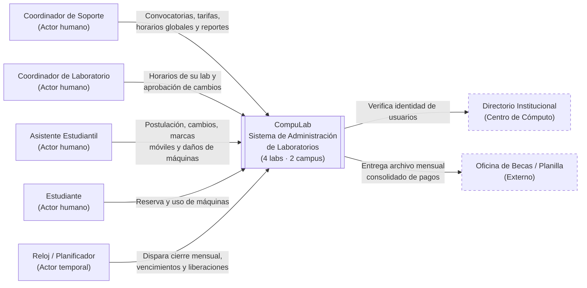

# 1. Requerimientos, Contexto y Alcance · CompuLab

## 1.1 Contexto del problema
La Escuela de Computación opera **cuatro laboratorios de cómputo distribuidos en dos campus**, atendidos por asistentes estudiantiles con beca de asistencia pagada por hora. Actualmente la operación depende de hojas de cálculo compartidas, correo electrónico, mensajería informal y ocupación de máquinas por orden de llegada, lo cual produce turnos sin cubrir, inconsistencias en el reporte mensual de horas a la Oficina de Becas, excesos sobre el tope semanal detectados tarde y estudiantes que encuentran los laboratorios cerrados o sin máquinas disponibles.

**CompuLab** ordena los cuatro procesos operativos de la Escuela: **reclutamiento de asistentes, gestión de horarios y turnos, reserva y disponibilidad de máquinas, y cierre mensual de pagos**.

---

## 1.2 Actores y sistemas externos

| Actor / Sistema | Tipo | Responsabilidades y alcance en CompuLab |
| :--- | :--- | :--- |
| **Coordinador de Soporte** | Actor humano | Dirige los 4 laboratorios. Abre convocatorias, gestiona entrevistas, admite/rechaza postulantes, asigna categoría (1 o 2) y tope semanal de horas (definido por Becas, editable), da de baja asistentes, ve y modifica horarios de **todos** los laboratorios, define tarifas y porcentaje de recargo, revisa excesos de tope sin pago y consulta métricas de uso y máquinas fuera de servicio para presupuesto. |
| **Coordinador de Laboratorio** | Actor humano | Uno por laboratorio. Arma y modifica el horario **solo de su laboratorio**, aprueba o rechaza cambios de turno (puede rechazar sin dar razón), recibe alertas de turnos sin cubrir, consulta turnos sin asignar/no cubiertos por semana y registra reparación de máquinas. |
| **Asistente Estudiantil** | Actor humano | Se postula indicando bloques disponibles y laboratorios, acepta o rechaza bloques fuera de su disponibilidad, puede renunciar, ofrece/toma/retira turnos, marca entrada y salida desde su celular en la puerta del laboratorio, y reporta máquinas fuera de servicio o reparadas. |
| **Estudiante** | Actor humano | Usuario más numeroso. Reserva y utiliza máquinas en los laboratorios dentro de las reglas establecidas. |
| **Reloj / Planificador** | Actor temporal | Dispara el cierre mensual el primer día de cada mes, el vencimiento de ofertas de turno (24 h antes), la liberación automática de reservas tras 15 min de ausencia y el marcado de turnos terminados sin marca de entrada. |
| **Directorio Institucional** | Sistema externo | Operado por el Centro de Cómputo. Provee la autenticación e identidad de cualquier persona que ingresa al sistema. |
| **Oficina de Becas / Planilla** | Sistema externo | No opera CompuLab. Fija el tope semanal de horas de cada asistente y recibe mensualmente el archivo consolidado con los montos a pagar. |

---

## 1.3 Catálogo de requerimientos funcionales

| ID | Módulo | Requerimiento |
| :--- | :--- | :--- |
| **RF-01** | Reclutamiento | Abrir una convocatoria semestral para postulación de asistentes. |
| **RF-02** | Reclutamiento | Permitir a un estudiante postularse indicando bloques horarios disponibles y laboratorios de preferencia. |
| **RF-03** | Reclutamiento | Citar y registrar entrevistas con entrevistador, fecha/hora y resultado. |
| **RF-04** | Reclutamiento | Admitir (asignando categoría 1 o 2 y tope semanal de Becas) o rechazar postulantes; un rechazado puede volver a postularse en el siguiente semestre. |
| **RF-05** | Reclutamiento | Permitir renuncia o baja de un asistente activo, bloqueando nuevas asignaciones y dejando sus turnos futuros sin cubrir con aviso oportuno. |
| **RF-06** | Reclutamiento | Permitir al Coordinador de Soporte actualizar el tope semanal de horas de un asistente si Becas lo modifica. |
| **RF-07** | Horarios | Armar y modificar turnos (laboratorio, día, inicio, fin, exactamente 1 asistente): sin traslapes (aun entre labs/campus), sin exceder el tope semanal y respetando disponibilidad declarada salvo aceptación explícita del asistente. |
| **RF-08** | Horarios | Restringir la edición de horario al laboratorio propio para Coordinadores de Laboratorio y permitir visibilidad/edición global al Coordinador de Soporte. |
| **RF-09** | Horarios | Permitir ofrecer, retirar (mientras nadie la tome) y tomar turnos dentro del mismo laboratorio; el cambio queda sujeto a aprobación del Coordinador de Laboratorio, revalidando traslape y tope semanal. Las ofertas no tomadas vencen 24 h antes del turno. |
| **RF-10** | Asistencia | Permitir al asistente marcar entrada y salida real desde celular en la puerta del laboratorio; si un turno termina sin marca de entrada, queda como no cubierto y se notifica al coordinador. |
| **RF-11** | Horarios | Consultar por semana los turnos sin asignar y los turnos terminados sin cubrirse. |
| **RF-12** | Máquinas | Permitir a un estudiante reservar una máquina disponible solo en franjas cubiertas por un turno (lab abierto), con duración máxima de 2 h, máximo 1 reserva activa simultánea y máximo 6 h acumuladas por semana. |
| **RF-13** | Máquinas | Liberar automáticamente una reserva si el estudiante no se presenta en los primeros 15 minutos, y cancelar reservas con aviso si el turno que cubría la franja cae. |
| **RF-14** | Máquinas | Permitir marcar una máquina como fuera de servicio (cancelando reservas futuras con aviso a los afectados) y devolverla a disponible al registrarse su reparación. |
| **RF-15** | Reportes | Mostrar al Coordinador de Soporte, por laboratorio y semana, cuántas máquinas estuvieron fuera de servicio y el uso de las demás para justificar presupuesto. |
| **RF-16** | Liquidación | Ejecutar el cierre del mes anterior el primer día de cada mes consolidando horas reales (marcas), aplicando tarifa por categoría y recargo a turnos que inicien a las 18:00 o después y a sábados y domingos. |
| **RF-17** | Liquidación | Registrar sin pago las horas trabajadas por encima del tope semanal y notificar al Coordinador de Soporte; garantizar que un mes cerrado sea inmutable e idempotente. |
| **RF-18** | Liquidación | Permitir a Coordinación de Soporte configurar tarifas por categoría y porcentaje de recargo por vigencia, y generar el archivo de cierre aceptado por Becas/Planilla. |

---

## 1.4 Alcance y exclusiones explícitas

**Incluido en esta versión:**
- Diseño completo de los cuatro procesos (reclutamiento, horarios/asistencia, máquinas y cierre mensual).
- Núcleo ejecutable de punta a punta para los tres casos de uso críticos: **Asignar turno**, **Reservar máquina** y **Cerrar mes con archivo para Becas**, con pruebas en memoria, funciones de aptitud y prototipo web interactivo UX/UI.

**Fuera de alcance (explícito del cliente):**
- La asignación de becas de asistencia y la verificación de sus requisitos académicos/socioeconómicos (CompuLab recibe la categoría y el tope de horas definidos por Coordinación de Soporte).
- El pago efectivo / transferencia bancaria (CompuLab únicamente calcula los montos y genera el archivo para Becas/Planilla).
- El inventario detallado de hardware más allá del identificador de máquina, su laboratorio y su estado de servicio (`Disponible` / `Fuera de servicio`).

---

## 1.5 Diagrama C4 · Nivel 1 (Contexto del Sistema)

> **Vista:** C4 Nivel 1 — Contexto del sistema · **Fecha:** 2026-11-21  
> **Leyenda:** Rectángulos redondeados = actores humanos o temporales · Caja central = sistema CompuLab (caja negra, sin detalles tecnológicos) · Cajas externas con borde punteado = sistemas externos fuera del control de la Escuela.

