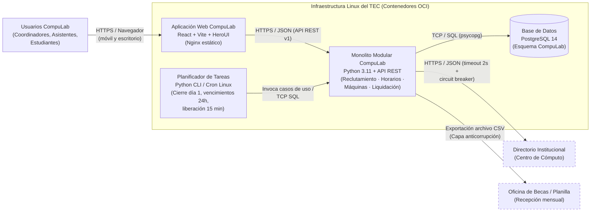
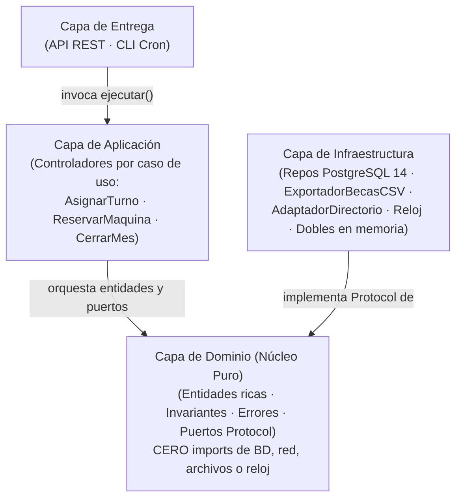

# 3. Arquitectura de Software · CompuLab

## 3.1 Estilo Arquitectónico Elegido

CompuLab adopta un **Monolito Modular** combinado internamente con **Puertos y Adaptadores (Arquitectura Hexagonal)**.

- **Qué compra:** Límites reales entre los cuatro dominios (`Reclutamiento`, `Horarios`, `Maquinas`, `Liquidacion`), despliegue simple en contenedores Linux para un equipo de 3 personas, latencia en nanosegundos entre módulos (sin saltos de red innecesarios) y **testeabilidad completa del dominio sin levantar PostgreSQL ni dependencias externas**.
- **Con qué lo paga:** Disciplina estricta de fronteras (respaldada automáticamente por las **funciones de aptitud** en `pytest`) y un mayor número de interfaces (`Protocol`) y adaptadores.
- **Por qué NO microservicios:** Con un equipo de 3 personas y 4 laboratorios, distribuir en microservicios impondría costos de red, despliegues coordinados y consistencia distribuida sin un driver de escala por servicio que lo justifique (ver `ADR-0001`).

---

## 3.2 Diagrama C4 · Nivel 2 (Contenedores)

> **Vista:** C4 Nivel 2 — Contenedores desplegables · **Fecha:** 2026-11-21  
> **Leyenda:** Cajas azules/sólidas = contenedores Linux desplegados en infraestructura TEC · Cilindro = base de datos · Cajas punteadas = sistemas externos · Toda flecha indica protocolo y dirección de llamada.

---

## 3.3 Vista Interna de Capas y Regla de Dependencia

Dentro del contenedor **Monolito Modular CompuLab**, las dependencias de código fuente apuntan **exclusivamente hacia adentro**, hacia el dominio puro:

Esta regla no queda solo en papel: se verifica en cada ejecución de `pytest` mediante la función de aptitud `tests/fitness/test_regla_dependencia.py`.

---

## 3.4 Modelo 4+1 de Kruchten (amarrado a escenarios críticos)

Escenario de referencia: **Un estudiante reserva una máquina en semana de matrícula con el Directorio Institucional lento (`QA-01`, `QA-02`, `QA-04`)**.

| Vista 4+1 | Qué responde en CompuLab |
| :--- | :--- |
| **Vista Lógica** | `ReservarMaquina` valida contra `Laboratorio`/`Turno` (franja cubierta), `Maquina` (disponible), reglas de `ReservaMaquina` (≤ 2 h, ≤ 1 activa, ≤ 6 h/sem) y persiste la reserva. |
| **Vista de Procesos** | La sesión del estudiante ya fue emitida y validada localmente (el *circuit breaker* hacia el Directorio evita bloqueos por matrícula). La transacción contra PostgreSQL 14 aplica bloqueo/restricción de exclusión atómica para que dos solicitudes simultáneas no dupliquen la reserva (< 500 ms p95). |
| **Vista de Desarrollo** | Paquetes `compulab/dominio/`, `compulab/aplicacion/` y `compulab/infraestructura/`. El dominio no importa infraestructura; los tests corren en milisegundos con `dobles.py` sin BD. |
| **Vista Física** | Contenedores Linux (Nginx + Frontend HeroUI, Monolito Python, Cron, PostgreSQL 14) en servidores internos del TEC, sin dependencias de nube externa. |
| **+1 Escenarios** | `QA-01` (p95 < 500 ms), `QA-02` (disponibilidad ante caída del Directorio), `QA-03` (tarifas sin redespliegue) y `QA-04` (cero traslapes concurrentes) verifican que las cuatro vistas son consistentes entre sí. |

---

## 3.5 Integraciones con Sistemas Externos (Hohpe & Woolf)

| Sistema externo | Estilo de integración | Por qué ese estilo | Protección / Capa anticorrupción | Qué costo se acepta |
| :--- | :--- | :--- | :--- | :--- |
| **Directorio Institucional** | **RPC sobre HTTPS** (autenticación en línea). | Se necesita confirmar identidad en tiempo real al iniciar sesión. | Adaptador dedicado con **timeout estricto (2 s)**, **circuit breaker** y sesiones con TTL propio para que picos de matrícula en el Directorio no tumben CompuLab. | Si el Directorio cae completamente, usuarios nuevos sin sesión activa no pueden iniciar sesión hasta que se recupere (los ya autenticados siguen operando). |
| **Oficina de Becas / Planilla** | **Transferencia de archivos (CSV estructurado)**. | La Oficina de Becas no usa CompuLab ni expone API; recibe un consolidado mensual una vez al mes. | Puerto `ExportadorBecas` implementado por `ExportadorBecasCSV`. Si Becas cambia columnas o formato, solo cambia ese adaptador sin tocar el dominio. | No hay confirmación automática inmediata de lectura por parte de Planilla; el cierre queda guardado e inmutable en CompuLab como respaldo auditable. |
